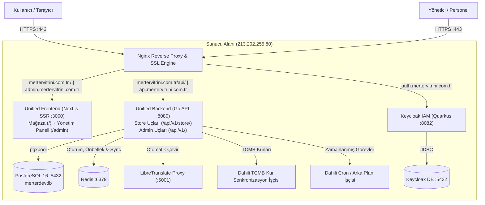

# Mimari Tasarım ve Servis İletişim Dokümanı (Architecture)

## 1. Genel Sistem Mimarisi (Birleştirilmiş & Sadeleştirilmiş Tasarım)

Merter Vitrini, yüksek eşzamanlılık (high concurrency), düşük gecikme süresi (low latency) ve operasyonel sadelik gözetilerek **Tek Birleşik Go Backend** ve **Tek Birleşik Next.js SSR Frontend** mimarisine dönüştürülmüştür.

Eski çift backend (:8081 shop + :8085 admin) ve çift frontend (SSR shop :3000 + statik /out export admin) yapısı kaynak israfına, Nginx 403 Forbidden çakışmalarına ve karmaşık deployment adımlarına yol açıyordu. Yeni mimaride bu problemler tamamen ortadan kaldırılmıştır.



---

## 2. Frontend Mimarisi (Unified SSR Next.js 16)

- **Konum:** [`frontend/`](file:///c:/Projects/mertervitrini.com.tr/frontend)
- **Teknoloji:** Next.js 16.2.6 (App Router), React 19.2.4, Tailwind CSS v4, Lucide React.
- **Çalışma Modu:** Canlı Node.js SSR (`systemd: merter-frontend`, Dinlenen Port: `3000`).
- **Rotasyon Yapısı (Unified Routing):**
  - `/`: Storefront Ana Sayfa, öne çıkan ürünler, slider ve kategoriler.
  - `/[categoryPrefix]/...`: Çok dilli ve hiyerarşik kategori listeleme sayfaları.
  - `/product/[slug]`: Ürün detay sayfası, varyant seçimi, beden tablosu ve toptan paket bilgileri.
  - `/profile`: Müşteri kontrol paneli, adres defteri, geçmiş siparişler ve iade talepleri.
  - `/tum-urunler`: Gelişmiş filtreleme (kategori, renk, kumaş, beden, fiyat aralığı).
  - `/admin`: **Admin Suite Yönetim Paneli** (SPA dashboard görünümü `/admin` rotasına monte edilmiştir).
  - `/admin/layout.tsx`: `robots: { index: false, follow: false }` metadata ile arama motoru dizinlemesine karşı tamamen kapatılmıştır.
  - `/sitemap.ts` & `/robots.ts`: Çok dilli SEO site haritaları ve robot direktifleri (admin rotalarını hariç tutar).
- **İstemci State Yönetimi:**
  - `src/components/store/`: `CartDrawer.tsx` (canlı sepet), `WishlistDrawer.tsx` (favoriler), `AuthModal.tsx` (Keycloak OIDC / Google OAuth).
  - `src/components/admin/`: `catalog/`, `orders/`, `integrations/`, `cron/`, `customers/`, `translate/`, `geography/`, `policies/`.
- **Hata Takibi:** `@sentry/nextjs` istemci ve sunucu katmanında tam entegre hata izleme.

---

## 3. Backend Mimarisi (Unified Go 1.25 REST API)

- **Konum:** [`backend/`](file:///c:/Projects/mertervitrini.com.tr/backend)
- **Çalışma Portu:** `8080` (`systemd: merter-backend`)
- **Modüler Paket Yapısı:**
  - **`config/`:** `config.json` veya ortam değişkenlerinden dinamik yapılandırma (varsayılan port: `8080`).
  - **`db/`:**
    - `db.go`: Tek `jackc/pgx/v5` (`pgxpool.Pool`) bağlantı havuzu. Başlangıçta sepet, sipariş, soru-cevap ve giriş geçmişi tablolarını otomatik temin eder (auto-provision).
    - `redis.go`: Paylaşımlı Redis istemcisi.
    - `rates_worker.go`: TCMB günlük kur çekme arka plan servisi.
  - **`middleware/`:**
    - `AuthMiddleware`: Keycloak RS256 açık anahtarı ve sistem JWT secret ile bearer token doğrulama.
    - `CORSMiddleware`: Domain bazlı HTTP Origin denetimi.
    - `RateLimitMiddleware`: Storefront uçlarında IP bazlı token bucket rate limiting.
    - `LoggingMiddleware`: Yapısal loglama ve istek süresi takibi.
  - **`handlers/`:** Tekilleştirilmiş tüm API işleyicileri:
    - Admin uçları (`admin_auth.go`, `admin_catalog.go`, `admin_orders.go`, `cron.go`, `integration.go`, vb.).
    - Store uçları (`store_auth.go`, `store_catalog.go`, `store_orders.go`, `store_cart.go`, `image.go`, vb.).
  - **`main.go`:** Go 1.22+ ServeMux rotalama kuralları, Swagger UI, TCMB döviz senkronizasyonu, arka plan cron scheduler ve graceful shutdown (10s timeout) yönetimi.

---

## 4. Servisler Arası İletişim ve API Standartları

1. **RESTful ve Versiyonlama Prensibi:**
   - Tüm servis uç noktaları versiyonlanmıştır: `/api/v1/...`
   - Storefront istekleri: `/api/v1/store/...`
   - Admin yönetim istekleri: `/api/v1/...`
2. **Yanıt Formatı Standardı:**
   - Başarılı yanıtlar standart JSON objesi olarak döner (`Content-Type: application/json`).
   - Hata yanıtları standart hata gövdesine sahiptir:
     ```json
     {
       "error": "Hata açıklaması",
       "code": 400
     }
     ```
3. **Güvenlik ve Yetkilendirme (Keycloak OIDC):**
   - Admin işlemleri `Bearer <Token>` başlığı gerektirir; Keycloak `merter` realm'inde tanımlı `realm_access.roles` (örn: `admin`, `catalog_manager`) kontrol edilir.
   - Storefront müşteri işlemleri hem oturumlu hem de misafir (guest) token akışlarını destekler.

---

## 5. Nginx Yapılandırma Sadeliği

Eski yapıda iki ayrı frontend (biri Node SSR, diğeri statik out) için ayrı Nginx kök dizinleri ve iki ayrı backend proxy'si gerekiyordu.
Yeni yapıda Nginx konfigürasyonu son derece basittir:

```nginx
# /etc/nginx/conf.d/mertervitrini.com.tr.conf

# 1. Frontend Proxy (Next.js SSR: Port 3000)
# Hem vitrin (/) hem yönetim paneli (/admin) aynı SSR servisi üzerinden çalışır.
location / {
    proxy_pass http://127.0.0.1:3000;
    proxy_http_version 1.1;
    proxy_set_header Upgrade $http_upgrade;
    proxy_set_header Connection 'upgrade';
    proxy_set_header Host $host;
    proxy_cache_bypass $http_upgrade;
    proxy_set_header X-Real-IP $remote_addr;
    proxy_set_header X-Forwarded-For $proxy_add_x_forwarded_for;
    proxy_set_header X-Forwarded-Proto $scheme;
}

# 2. Backend API Proxy (Go: Port 8080)
# Tüm API istekleri (store ve admin) tek backend servisine iletilir.
location /api/ {
    proxy_pass http://127.0.0.1:8080/api/;
    proxy_http_version 1.1;
    proxy_set_header Host $host;
    proxy_set_header X-Real-IP $remote_addr;
    proxy_set_header X-Forwarded-For $proxy_add_x_forwarded_for;
    proxy_set_header X-Forwarded-Proto $scheme;
}

# 3. Medya / Görseller
location /uploads/ {
    alias /var/www/media/;
    expires 30d;
    add_header Cache-Control "public, max-age=2592000, immutable";
}
```
