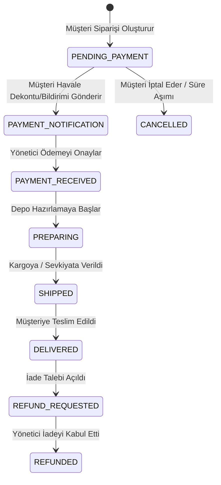

# Kritik İş Mantığı ve Güvenlik Kuralları (Business & Security Rules)

## 1. Açık Firma Profili ve Doğrudan Tedarikçi Kimliği Kuralı

Merter Vitrini, İstanbul Merter'deki tekstil üreticilerini ve toptancı firmaları küresel alıcılarla doğrudan buluşturan açık bir B2B ticaret ve tanıtım platformudur. Bu nedenle:
1. **Gerçek Firma Adları ve Profilleri Vitrinde Açıkça Gösterilir:**
   - Veritabanındaki `catalog.brands.brand_name` (örn: *Lustrin Toptan Tekstil*, *Etika Fashion*, *Jane's Toptan*) müşteri arayüzünde (Storefront, Mobil Uygulama) ve dışa açık katalog API'lerinde **gizlenmeden, gerçek ticari isimleriyle** sunulur.
   - `catalog.mv_products` Materialized View ve tüm katalog sorguları doğrudan `b.brand_name` alanını döner:
     ```sql
     b.brand_name AS brand_name
     ```
2. **Açık Firma İletişimi ve Entegrasyon Kaynağı Ayrımı:**
   - Firmanın vitrinde paylaşmayı seçtiği iletişim bilgileri (WhatsApp hattı, telefon, e-posta, açık adres, web sitesi) firma profil sayfasında ve ürün detaylarında alıcılara açıkça gösterilir.
   - `alias_code` (`MIMOZA`, `FLORA`, `EDUSA` vb.) yalnızca otomatik üretilen benzersiz ürün stok kodlarında (`custom_sku`) kısa ön ek olarak kullanılır; firma adını gizlemek için **kullanılmaz**.
   - Yalnızca tedarikçiye ait arka plan XML entegrasyon adresi (`integration.xml_feeds.feed_url`) ve tedarikçi alış maliyeti (`buying_price`) dışa açık (public) API çıktılarından gizlenir.

---

## 2. SKU ve Benzersiz Tanımlayıcı Formatları

Ürünlerin stok kodları (SKU), depo ve entegrasyon süreçlerinin hatasız yürümesi için sıkı bir standarda bağlıdır:
1. **Ana Ürün SKU Kuralı:**
   - Format: `[ALIAS_CODE]-[BASE36_SLUG_ID]`
   - Örnek: `MIMOZA-255S`, `FLORA-10A4`
   - Tetikleyici: `catalog.trig_product_custom_sku_before` tarafından otomatik oluşturulur.
2. **Varyant SKU Kuralı (Beden / Seri):**
   - Format: `[ÜRÜN_SKU]-[BEDEN_SLUG]`
   - Örnek: `MIMOZA-255S-S`, `MIMOZA-255S-M`, `MIMOZA-255S-38`
3. **Tekli Satış Varyant SKU Kuralı:**
   - Eğer ürün toptan seri yerine tekli parçalar halinde satılıyorsa sonuna `-single` eklenir:
   - Örnek: `MIMOZA-255S-S-single`
   - Tetikleyici: `catalog.trig_variant_custom_sku_before` tarafından otomatik oluşturulur.

---

## 3. B2B Toptan Satış, Seri ve Paketleme Kuralları

1. **Seri Oranı (`series_ratio`) ve Koli Oranı (`packing_ratio`):**
   - Toptan hazır giyimde ürünler seriler halinde (örn: `1-2-2-1` -> 1 Adet S, 2 Adet M, 2 Adet L, 1 Adet XL) satılır.
   - Sepet ve sipariş süreçlerinde minimum sipariş miktarı (`minimum_order_quantity`) denetlenir.
   - Müşterinin sepetine eklediği adetler, serinin katları olmak zorundadır (tekli satış istisnası hariç).
2. **Tekli Fiyat Gösterimi (`show_single_price`):**
   - Sistem ayarlarında (`catalog.settings.show_single_price`) açık ise seriye ek olarak tek parça birim fiyatı vitrinde hesaplanarak gösterilir.
3. **Doğrudan Tedarikçi Fiyatı Kuralı (%0 Platform Fiyat Marjı):**
   - Tedarikçilerin XML entegrasyonlarından (`etika.py`, `janes.py`, Go XML Sync) veya Tedarikçi Portalı'ndan girilen fiyatlar, üzerine herhangi bir komisyon veya kâr marjı (`PROFIT_RATE = 0.0`) eklenmeden **birebir tedarikçinin kendi fiyatı** olarak vitrinde gösterilir (`price = buying_price`).

---

## 4. Çoklu Para Birimi ve TCMB Döviz Entegrasyonu

1. **Temel Muhasebe Para Birimi:** `TRY` (Türk Lirası).
2. **Döviz Kurları Arka Plan İşçisi:**
   - Storefront Backend servisi ayağa kalktığında `db.StartRatesWorker` arka planda çalışmaya başlar.
   - Türkiye Cumhuriyet Merkez Bankası (TCMB) günlük XML kur servisini sorgular ve `catalog.exchange_rates` tablosuna yazar.
   - Vitrin arayüzünde kullanıcı USD, EUR, RUB vb. para birimlerini seçtiğinde fiyatlar TCMB efektif satış/alış kurlarıyla anlık dönüştürülür.

---

## 5. Çok Dillilik (i18n) ve SEO Standartları

1. **Desteklenen Diller:** Türkçe (`tr`), İngilizce (`en`), Rusça (`ru`), Arapça (`ar` - Sağdan Sola RTL).
2. **SEO Uyumlu Slug Standardı:**
   - Başlıklar URL formatına dönüştürülürken `catalog.fn_slugify` fonksiyonu Türkçe karakterleri uluslararası standartta temizler (`ı->i`, `ş->s`, `ğ->g`, `ü->u`, `ö->o`, `ç->c`).
   - Benzersizliği garanti etmek için slug'ın sonuna Base36 kimliği eklenir: `[temiz-baslik]-[slug_id]`.
3. **IndexNow Arama Motoru Entegrasyonu:**
   - Yeni ürün eklendiğinde, güncellendiğinde veya blog yazısı yayımlandığında IndexNow API (`/api/v1/indexnow/submit`) üzerinden Yandex, Bing ve arama motorlarına anında bildirim gönderilir.
4. **Google Merchant XML Feed:**
   - Canlı ürün kataloğu Google Merchant formatında `/api/v1/store/feeds/google-merchant.xml` rotasından dinamik XML olarak üretilir.

---

## 6. Sipariş ve Havale/EFT Yaşam Döngüsü (Order Lifecycle)



1. **`PENDING_PAYMENT`:** Sipariş açıldı, stok bloke edildi, havale bekleniyor.
2. **`PAYMENT_NOTIFICATION`:** Müşteri banka adı, tutar ve dekont bilgisini girdi (`catalog.payment_notifications`).
3. **`PAYMENT_RECEIVED`:** Satış/Muhasebe yöneticisi banka hesabını teyit edip ödemeyi onayladı.
4. **`PREPARING`:** Depo sipariş kalemlerini toplamaya başladı.
5. **`SHIPPED`:** Taşıma/Kargo takip kodu girildi.
6. **`DELIVERED`:** Teslimat tamamlandı.

---

## 7. Görsel İşleme ve WebP Optimizasyonu

1. **Dinamik Yeniden Boyutlandırma:**
   - `/api/v1/store/images/resize?url=...&w=400&h=600&q=80`
   - Orijinal yüksek çözünürlüklü görseller sunucu kaynaklarını tüketmemek için WebP formatına sıkıştırılır.
2. **Toplu Önceden Üretim (Bulk Pre-generation):**
   - Yeni XML entegrasyonu tamamlandığında binlerce görselin mağaza açılışını yavaşlatmaması için `StartBulkResize` ile arka planda toplu optimizasyon başlatılır ve `bulk-status` üzerinden takip edilir.
