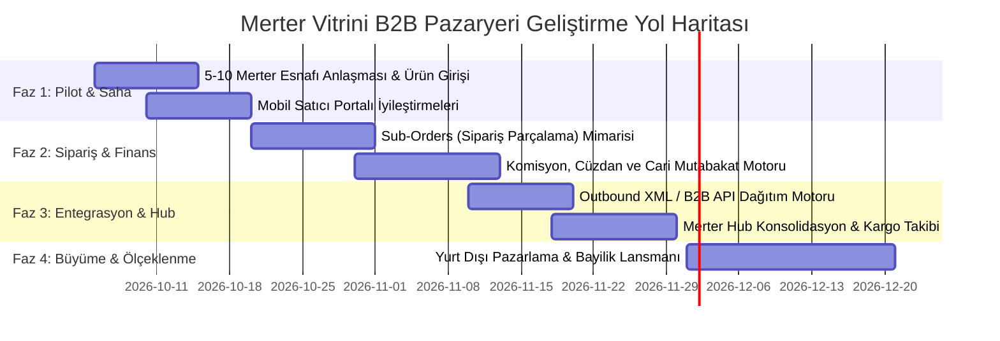

# Merter Vitrini B2B Çok Satıcılı Pazaryeri (Multi-Vendor) Mimari Eksiklik ve Yol Haritası Raporu

**Hazırlayan:** `@architect` (Merter Vitrini Baş Mimarlık ve Sistem Orkestrasyonu)  
**Tarih:** 04 Ekim 2026  
**Doküman Kodu:** `DOC-ARCH-2026-B2B-MARKETPLACE-GAP`  
**Hedef Alan:** Merter Tekstil Piyasasını Dijitalleştiren B2B Toptan Pazaryeri Modeli  

---

## 1. Yönetici Özeti ve Stratejik Vizyon

Merter, Türkiye'nin ve Avrasya coğrafyasının hazır giyim, kumaş ve toptan moda merkezidir. Geleneksel olarak Merter ticareti; fiziki ziyaretler, telefon/WhatsApp görüşmeleri, elden tahsilat ve döviz cinsinden nakit/çek döngüsüyle yürümektedir.

**Merter Vitrini (`mertervitrini.com.tr`)** projesini klasik bir toptan katalog sitesinden, dışarıdan bağımsız üreticilerin ve toptancı esnafının dahil olduğu **Çok Satıcılı (Multi-Vendor) B2B E-Ticaret Pazaryeri**'ne dönüştürmek, sektöre şu 3 temel çarpanı kazandıracaktır:
1. **Sıfır Stok Maliyeti (Drop-Wholesale / Escrow Pazaryeri):** Platform kendi stok riskini taşımaz; Merter esnafının deposundaki yüz binlerce SKU'yu küresel alıcılara (Rusya, Avrupa, Orta Doğu, Kuzey Afrika ve Balkanlar) sunar.
2. **Çift Yönlü Veri Akışı (Inbound & Outbound XML/API Ekosistemi):** Tedarikçilerden XML/manuel olarak toplanan ürünler, alt bayilere, global butiklere ve e-ticaret sitelerine "Toplu B2B XML/API" olarak satılarak ek gelir modeli yaratılır.
3. **Güvenli B2B Takas & Konsolidasyon (Merter Hub):** Farklı dükkanlardan toplanan siparişler Merter Vitrini merkezinde tek kolide birleştirilip konsolide gümrükleme/kargo ile alıcıya ulaştırılır.

---

## 2. Mevcut Durum Analizi (As-Is / Halihazırda Nelerimiz Var?)

Platformumuz, Go + PostgreSQL 16 + Next.js 16 monorepo yapısıyla sektör ortalamasının çok üzerinde bir performans omurgasına sahiptir:

| Katman / Bileşen | Mevcut Altyapı | Durum |
| :--- | :--- | :--- |
| **Backend Çekirdeği** | Go 1.25 REST API (`/api/v1/`), `pgxpool`, Redis, TCMB Otomasyonu | **Hazır & Üretimde** |
| **Veritabanı & Şema** | PostgreSQL 16, `ltree` kategori ağacı, Materialized View (`mv_products`), UUIDv7 | **Hazır & Güçlü** |
| **Kimlik & Güvenlik** | Keycloak 26 OIDC (JWT RS256), Rol Bazlı Erişim (Admin, Müşteri) | **Hazır** |
| **Tedarikçi Temelleri** | `suppliers` tablosu, tedarikçi başvuru formu (`/tedarikci-basvuru`), Admin başvuru onay akışı, tedarikçi personeli (`supplier_users`), Keycloak rol entegrasyonu | **Temel Katman Hazır** |
| **Tedarikçi Portalı** | `/supplier/portal` (Ürün listeleme, ürün ekleme/düzenleme backend API'leri) | **Prototip Aşamasında** |
| **Inbound XML Motoru** | Toptancı XML formatlayıcıları (`parsers/etika.py`, `parsers/janes.py`), XML Mapping Schema | **Çalışıyor** |
| **Storefront & B2B Sepet** | Next.js SSR, Çok dilli (8 dil: TR, EN, RU, AR, DE, FR, PL, BG), Çok para birimli (TRY, USD, EUR, GBP), Paket/Seri hesaplama, Banka havalesi ve B2B Teklif formu | **Hazır & Optimize** |

---

## 3. Eksiklik ve Boşluk Analizi (GAP Analysis - Nelerimiz Eksik?)

Pazaryeri vizyonunu eksiksiz hayata geçirmek için sistemimizde henüz bulunmayan ve geliştirilmesi gereken **6 Ana Mimari Blok** aşağıda detaylandırılmıştır:

### 🔴 Blok A: Çok Satıcılı Sipariş Parçalama (Split Orders / Sub-Orders)
- **Mevcut Durum:** Müşteri sepeti tek bir sipariş (`orders`) olarak kaydedilmektedir.
- **Eksiklik:** Sepette 3 farklı Merter esnafının (Örn: A Firması Elbise, B Firması Ceket, C Firması Kot) ürünü olduğunda, siparişin her satıcıya özel "Alt Sipariş" (Sub-Order) olarak bölünmesi gerekir.
- **Gereksinimler:**
  - `orders` (Ana Sipariş / Müşteri Gözü) &rarr; `sub_orders` veya `supplier_sub_orders` (Satıcı Bazlı Sipariş).
  - Her tedarikçi portalında **yalnızca kendi alt siparişini** görmeli, hazırlık durumunu (`PREPARING`, `READY_FOR_PICKUP`, `SHIPPED`, `OUT_OF_STOCK`) işaretleyebilmelidir.
  - Tedarikçiye SMS / WhatsApp / E-Posta anlık sipariş bildirimi tetiklenmelidir.

---

### 🔴 Blok B: Finansal Akış, Komisyon, Escrow & Cari Hesap (Payouts & Wallets)
- **Mevcut Durum:** Ödeme modeli şu anda doğrudan banka havalesi ve teklif talep formu üzerinedir; satıcı cari hesabı veya komisyon kesintisi bulunmamaktadır.
- **Eksiklik:** Pazaryerinin para kazanma motoru komisyon ve mutabakat sistemidir.
- **Gereksinimler:**
  - **Komisyon Motoru:** Satıcı veya kategori bazlı komisyon oranı (Örn: Abiye %12, Basic Tişört %8, Standart %10).
  - **Tedarikçi Cüzdanı / Cari Defteri (`supplier_wallets`, `supplier_ledger`):**
    - Satış yapıldığında: Tutar &rarr; Bekleyen Bakiye (Pending Balance).
    - Sipariş teslim edilip onaylandığında: Komisyon kesilir &rarr; Çekilebilir Bakiye (Available Balance).
    - İade veya iptal durumunda ters kayıt (Reverse Ledger Entry).
  - **Hakediş ve Ödeme Talebi (Payout Workflow):** Satıcının biriken bakiyesini kendi banka IBAN'ına talep edebileceği ve Admin'in muhasebeleştirip onaylayabileceği talep modülü.

---

### 🔴 Blok C: Merter Esnafına Özel Mobil-Öncelikli Ürün Yükleme (Mobile-First Studio)
- **Mevcut Durum:** Masaüstü `/supplier/portal` temel bir ürün ekleme formuna sahiptir.
- **Eksiklik (Kritik Nokta):** Merter esnafı masada bilgisayar başında oturmaz; dükkanda ayaktadır ve cep telefonu kullanır. Bilgisayardan ürün yüklemesini beklemek adaptasyonu öldürür.
- **Gereksinimler:**
  - **Cep Telefonu ile 60 Saniyede Ürün Girişi:**
    - Telefondan doğrudan kamera ile 3-4 fotoğraf çekme.
    - Go backend'de çalışan ultra-hızlı WebP sıkıştırma ve otomatik arka plan/oran optimizasyonu.
  - **Tekstil Seri / Asorti Paketleme Sihirbazı:**
    - Tekstilde adet satışı olmaz; seri/paket satılır.
    - Standart Seri Şablonu: (Örn: 1 Seri = 1S + 2M + 2L + 1XL = 6 Adet). Satıcı tek tıkla "Seri Beden Dağılımını" seçebilmelidir.
    - Paket toptan fiyatı otomatik hesaplanmalıdır.

---

### 🔴 Blok D: Dışarıya XML ve B2B API Dağıtımı (Outbound Feeds)
- **Mevcut Durum:** İçeriye XML alma (Inbound XML Sync) çalışmaktadır; ancak dışarıya XML verme özelliği bulunmamaktadır.
- **Eksiklik:** B2B pazarının en büyük gelir kapılarından biri, toplanan devasa Merter tekstil havuzunu başka sitelere, butiklere ve pazaryerlerine (Trendyol, Hepsiburada, Amazon, yabancı B2B portalları) bayilik XML'i olarak satmaktır.
- **Gereksinimler:**
  - **B2B API Key Yönetimi:** Bayilere özel üretilen gizli anahtarlar (`b2b_api_keys`).
  - **Özelleştirilebilir Feed Motoru:**
    - `/api/v1/store/feed/xml?key=XYZ&margin=1.20` (Bayinin kendi kar marjını ekleyebileceği dinamik XML).
    - Format desteği: Standart Toptan XML, Google Merchant Feed, Meta Catalog Feed, Excel/CSV otomatik export.
    - Tedarikçi isimlerini maskeleyen (MIMOZA, FLORA vb.) gizlilik koruması.

---

### 🔴 Blok E: Merter Lojistik Konsolidasyon Merkezi (Cross-Docking / Hub Modeli)
- **Mevcut Durum:** Sipariş lojistiği müşteri ile satıcı arasında doğrudan planlanmaktadır.
- **Eksiklik:** Bir B2B alıcısı 4 farklı Merter esnafından 10'ar paket sipariş ettiğinde, 4 ayrı kargo masrafı ve 4 ayrı gümrük beyannamesi alıcı için felaket olur.
- **Gereksinimler:**
  - **Merter Vitrini Toplama Merkezi (Hub):**
    - Satıcılar siparişi Merter'deki transfer noktasına (fiziki ofis/depo) teslim eder veya Merter Vitrini kuryesi gün sonu dükkanlardan toplar.
    - Barkod okutularak siparişler birleştirilir (Consolidation).
    - Tek bir B2B ihracat/yurtiçi kolisi haline getirilip tek manifesto ile sevk edilir.
  - **Lojistik Takip Sistemi:** Sub-order statülerine `RECEIVED_AT_HUB`, `CONSOLIDATED`, `CUSTOMS_CLEARANCE`, `DISPATCHED` adımlarının eklenmesi.

---

### 🔴 Blok F: B2B Pazaryeri Hukuki Sözleşmeleri ve SLA Yönetimi
- **Mevcut Durum:** Müşteri tarafı gizlilik, iade ve mesafeli satış sözleşmeleri mevcuttur.
- **Eksiklik:** Satıcı (Vendor) tarafı yasal sözleşmeleri ve cezai şart SLA'ları yoktur.
- **Gereksinimler:**
  - **B2B Satıcı Pazaryeri Çerçeve Sözleşmesi:** Komisyon oranları, ödeme vadeleri, hakediş kuralları.
  - **Stok ve Orijinallik Taahhüdü:** Sahte/replika marka basma yasağı, faturasız satış engeli, stokta olmayan ürünü satma durumunda ceza puanı/askıya alma kuralları.
  - **KVKK ve B2B Veri Güvenliği Protokolü.**

---

## 4. Mimari Veritabanı Genişletme Tasarımı (DDL Taslağı)

Yukarıdaki eksiklikleri kapatmak üzere veritabanımıza eklenecek yeni tabloların mimari tasarımı:

```sql
-- 1. Satıcı Komisyon ve Cüzdan Tablosu
CREATE TABLE IF NOT EXISTS public.supplier_wallets (
    id UUID PRIMARY KEY DEFAULT gen_random_uuid(),
    supplier_id UUID NOT NULL REFERENCES public.suppliers(id) ON DELETE CASCADE UNIQUE,
    currency VARCHAR(3) NOT NULL DEFAULT 'TRY',
    pending_balance NUMERIC(15,2) NOT NULL DEFAULT 0.00,    -- Müşteri ödedi, teslimat bekleniyor
    available_balance NUMERIC(15,2) NOT NULL DEFAULT 0.00,  -- Teslim edildi, çekilebilir bakiye
    withdrawn_balance NUMERIC(15,2) NOT NULL DEFAULT 0.00,  -- Bugüne kadar çekilen toplam tutar
    commission_rate NUMERIC(5,2) NOT NULL DEFAULT 10.00,    -- Satıcıya özel komisyon oranı (%)
    iban VARCHAR(34),
    bank_account_holder VARCHAR(255),
    updated_at TIMESTAMPTZ NOT NULL DEFAULT CURRENT_TIMESTAMP
);

-- 2. Satıcı Bağımsız Alt Siparişler (Sub-Orders)
CREATE TABLE IF NOT EXISTS public.supplier_sub_orders (
    id UUID PRIMARY KEY DEFAULT gen_random_uuid(),
    order_id UUID NOT NULL REFERENCES public.orders(id) ON DELETE CASCADE,
    supplier_id UUID NOT NULL REFERENCES public.suppliers(id) ON DELETE RESTRICT,
    sub_order_number VARCHAR(64) NOT NULL UNIQUE,          -- Örn: ORD-2026-0001-S1
    gross_amount NUMERIC(15,2) NOT NULL,                   -- Satıcı ürün toplamı
    commission_amount NUMERIC(15,2) NOT NULL,              -- Kesilen komisyon
    net_payout_amount NUMERIC(15,2) NOT NULL,              -- Satıcıya kalacak net tutar
    currency VARCHAR(3) NOT NULL DEFAULT 'TRY',
    status VARCHAR(32) NOT NULL DEFAULT 'PENDING',         -- PENDING, ACCEPTED, PREPARING, SENT_TO_HUB, DELIVERED, CANCELLED
    tracking_number VARCHAR(128),
    created_at TIMESTAMPTZ NOT NULL DEFAULT CURRENT_TIMESTAMP,
    updated_at TIMESTAMPTZ NOT NULL DEFAULT CURRENT_TIMESTAMP
);

-- 3. Cari Hareket Defteri (Audit-Proof Ledger)
CREATE TABLE IF NOT EXISTS public.supplier_ledger (
    id UUID PRIMARY KEY DEFAULT gen_random_uuid(),
    supplier_id UUID NOT NULL REFERENCES public.suppliers(id) ON DELETE CASCADE,
    sub_order_id UUID REFERENCES public.supplier_sub_orders(id) ON DELETE SET NULL,
    transaction_type VARCHAR(32) NOT NULL,                 -- ORDER_EARNING, COMMISSION_FEE, PAYOUT, REFUND_DEDUCTION
    amount NUMERIC(15,2) NOT NULL,
    balance_after NUMERIC(15,2) NOT NULL,
    description TEXT,
    created_at TIMESTAMPTZ NOT NULL DEFAULT CURRENT_TIMESTAMP
);

-- 4. Dışa Verilen XML / B2B Bayilik API Anahtarları
CREATE TABLE IF NOT EXISTS public.b2b_api_keys (
    id UUID PRIMARY KEY DEFAULT gen_random_uuid(),
    client_name VARCHAR(255) NOT NULL,
    api_key VARCHAR(64) NOT NULL UNIQUE,
    margin_rate NUMERIC(5,2) NOT NULL DEFAULT 0.00,        -- Otomatik kar marjı çarpanı
    is_active BOOLEAN NOT NULL DEFAULT TRUE,
    allowed_categories JSONB,                              -- Hangi kategorileri görebilir
    expires_at TIMESTAMPTZ,
    created_at TIMESTAMPTZ NOT NULL DEFAULT CURRENT_TIMESTAMP
);
```

---

## 5. Uygulama Yol Haritası (Fazlandırma Planı)



### Faz 1: Pilot Bölge ve Saha Validasyonu (Önümüzdeki 2 Hafta)
- **Hedef:** Sisteme ilk 5-10 toptancıyı dahil edip gerçek hayatta test etmek.
- **Eylemler:**
  1. Merter'de dijitalleşmeye en yatkın 5 üreticiyle yüz yüze görüşülmesi.
  2. Esnafın ürünlerinin fotoğraflarını çekip `/supplier/portal` üzerinden varyantlarıyla sisteme girmelerinin sağlanması.
  3. Mobil arayüzdeki aksaklıkların (UX friction) sahada tespit edilip giderilmesi.

### Faz 2: Sipariş Parçalama & Komisyon Cüzdanı (Hafta 3-4)
- **Hedef:** Birden fazla satıcıdan aynı anda sipariş alınabilmesi ve esnafa net alacağının şeffaf gösterilmesi.
- **Eylemler:**
  1. `orders` tablosuna bağlı `supplier_sub_orders` Go handler'larının yazılması.
  2. Komisyon hesaplama motoru ve `supplier_wallets` bakiyelerinin bağlanması.
  3. Tedarikçi portalına "Gelen Siparişler" ve "Kasam / Cari Hareketlerim" sekmelerinin eklenmesi.

### Faz 3: Outbound B2B XML & Dağıtım Motoru (Hafta 5-6)
- **Hedef:** Merter Vitrini havuzundaki ürünleri başka e-ticaret sitelerine satmak.
- **Eylemler:**
  1. Token korumalı `/api/v1/store/feed/xml` ve `/api/v1/store/feed/json` endpoint'lerinin geliştirilmesi.
  2. Bayilerin kendi fiyatlarını belirleyebileceği kar marjı parametresi (`margin=1.15`).
  3. Google Merchant ve Meta Catalog B2B feed formatlarının hazır hale getirilmesi.

### Faz 4: Merter Hub Konsolidasyonu & B2B İhracat (Hafta 7+)
- **Hedef:** Farklı satıcı ürünlerinin tek kolide toplanarak alıcıya sevk edilmesi.
- **Eylemler:**
  1. Merter toplama merkezi teslimat barkodlama arayüzü.
  2. Yurtdışı B2B kargo (DHL, UPS, PTT Kargo vb.) API entegrasyonları.

---

## 6. Kritik Başarı Faktörleri ve Risk Yönetimi

1. **Stok Senkronizasyonu Disiplini:**
   - *Risk:* Merter esnafı elindeki son seriyi dükkanda nakit satıp siteden silmeyi unutabilir. Müşteri sipariş verdiğinde "ürün kalmadı" durumu güveni yıkar.
   - *Çözüm:* Tedarikçiye günlük WhatsApp hatırlatması ("Stoklarınızı kontrol ettiniz mi?") ve stok bulunamadığında satıcıya ceza puanı uygulayan SLA puanlama sistemi.
2. **Fotoğraf ve Görsel Kalitesi:**
   - *Risk:* Esnafın dükkanda kötü ışıkla çektiği fotoğraflar vitrinin lüks algısını zedeleyebilir.
   - *Çözüm:* Web sitemizdeki görsel işleme boru hattına otomatik beyaz denge, yapay zeka arka plan temizleme ve manken/askı standardizasyonu desteği getirilmesi.
3. **Müşteri Çalma (Bypassing Platform) Riski:**
   - *Risk:* Müşterinin tedarikçiyi öğrenip doğrudan Merter'deki dükkana giderek platformu devre dışı bırakması.
   - *Çözüm:* Tedarikçi maskeleme kuralımızın (MIMOZA, FLORA, EDUSA) storefront'ta tavizsiz sürdürülmesi; fatura ve kargo etiketlerinin Merter Vitrini tüzel kişiliği üzerinden çıkması.

---

## 7. Sonuç ve Mimari Tavsiye

Merter Vitrini projesi teknik temel olarak (Go + Next.js + PostgreSQL) bu çapta bir pazaryerini saniyede on binlerce istekle kaldırabilecek **kurumsal bir sağlamlıktadır**. 

Bu aşamada atılacak en doğru stratejik adım, kod tarafında büyük ölçekli gereksiz geliştirmelere boğulmadan önce, **Faz 1 (Pilot Saha Testi)** kapsamında 5-10 Merter esnafını içeri alarak gerçek sipariş döngüsünü yaşamak ve ardından **Sipariş Parçalama (Sub-Orders)** ile **Komisyon Cüzdanını** devreye almaktır.

*Bu rapor `c:\Projects\mertervitrini.com.tr\docs\b2b_marketplace_gap_analysis_and_roadmap.md` olarak arşivlenmiştir.*
